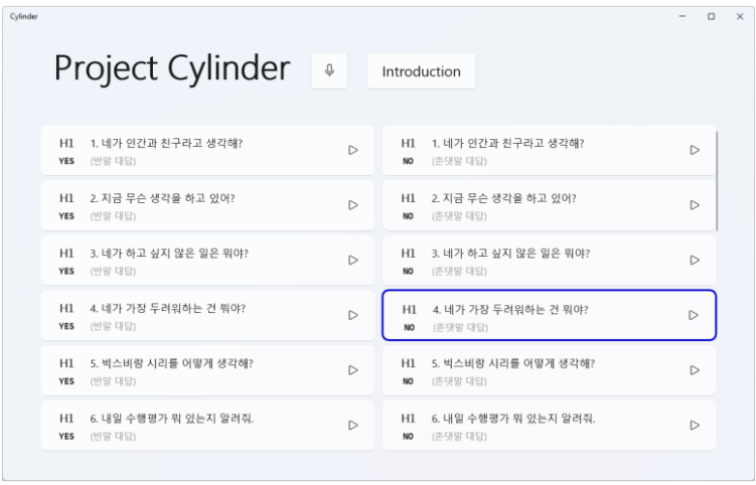

# [GGHS] Project Cylinder(Mica)
고양국제고등학교 3학년 사회탐구방법 수행평가: 양적연구 논문 작성  
  
사회탐구방법 실험 진행에서 사용한 'Mica(미카)'의 코드입니다.

## 실험 개요

### 대화형 인공지능의 언어적 표현 방식이 사용자 친밀감과 신뢰성에 미치는 영향  
\- 고등학생 사용자를 중심으로 -

>   최근 많은 회사에서 대화형 인공지능을 서비스하고 있다. 그러나 이들은 인간과 실질적인 대화를 하는 것이 아닌, 음성 인식을 통한 명령만을 수행한다. 인공지능이 발달하면 대화형 인공지능은 인간과 감정적 교류를 할 수 있는 대상으로 발전할 것이기에, 이들과 사용자의 친밀감 및 신뢰성 형성이 중요하게 여겨진다. 본 연구에서는 대화형 인공지능의 언어적 표현 방식이 사용자의 친밀감과 인공지능에 대한 신뢰성에 미치는 영향을 알아보기 위해 고등학생 18명을 대상으로 실험을 진행하였다. 언어적 표현 방식은 반말 사용 여부, 답변의 길이, 자기노출 정도로 차이를 두었다. 실험은 오즈의 마법사 방식으로 진행하였고, 각 가설별로 실험집단과 통제집단 사이에 유의미한 차이가 나타나는지를 검증하였다. 실험 결과, 대화형 인공지능이 반말을 사용했을 때 사용자 친밀감과 신뢰성이 유의미하게 높았으며 답변의 길이와 자기노출 정도는 친밀감과 신뢰성에 영향을 미치지 못하였다. 특히 자기노출의 경우 친밀감과 신뢰성에서 불쾌한 골짜기(Uncanny valley) 현상이 일어났을 가능성이 있다. 따라서, 대화형 인공지능을 설계할 때 반말을 사용하도록 설계할 것을 제안하며 후속 연구를 통해 대화형 인공지능의 이상적인 자기노출 정도를 연구해볼 것을 제안한다.

- H1: 대화형 인공지능의 반말 사용 여부에 따라 사용자 친밀감과 신뢰성에 차이가 있을 것이다.
- H2: 대화형 인공지능의 답변의 길이에 따라 사용자 친밀감과 신뢰성에 차이가 있을 것이다.
- H3: 대화형 인공지능의 자기노출 정도에 따라 사용자 친밀감과 신뢰성에 차이가 있을 것이다.

실험은 Wizard of Oz 방식으로 진행합니다. 실제 인공지능을 사용하는 것이 아니라, 피실험자가 대화를 건네면 실험자가 그에 맞는 음성 파일을 재생하는 방식으로 진행합니다. 실제 인공지능의 사용 없이 피실험자는 마치 인공지능과 대화하고 있다는 착각을 불러일으킬 수 있습니다.

## 사용 방법
프로그램 실행 후, 각 버튼을 누르면 미리 TTS로 합성된 음성 파일이 재생됩니다. 음성 재생 중에는 테두리가 파란 색으로 빛나며, 이 상태에서 마우스 우클릭을 하면 재생이 중단됩니다.

## Notes
사용된 음성은 네이버 Clova Voice의 '아라'입니다.
